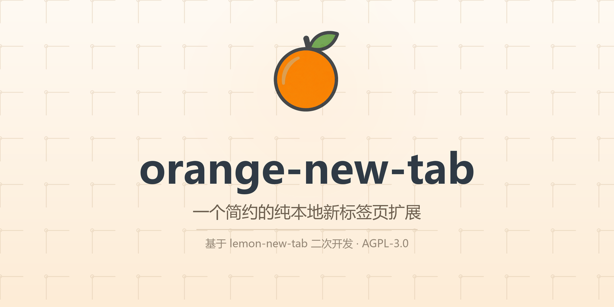
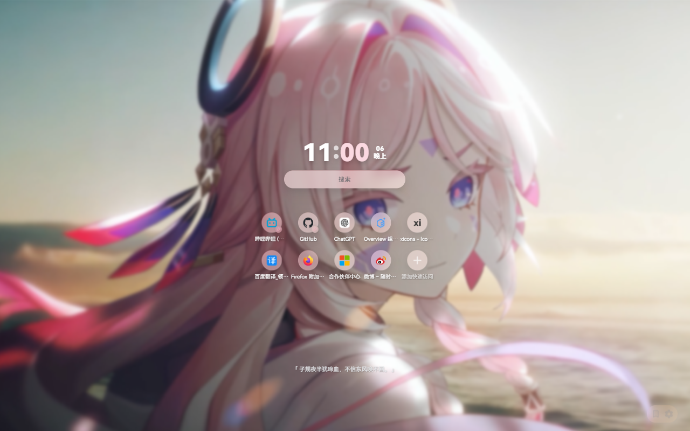
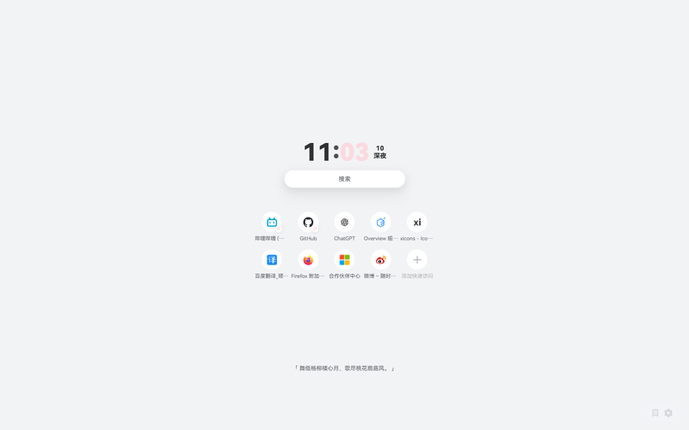
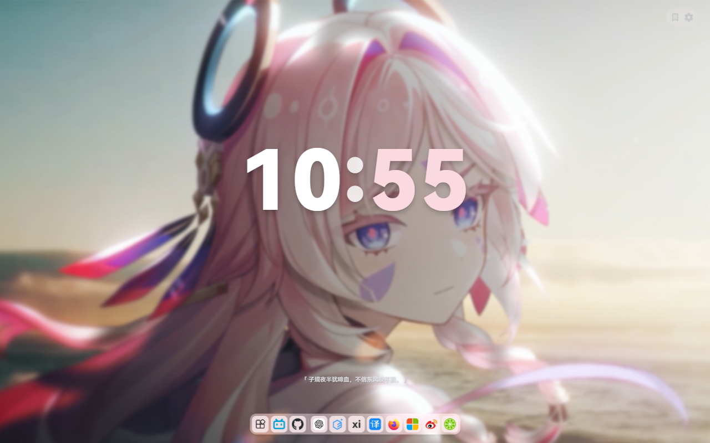
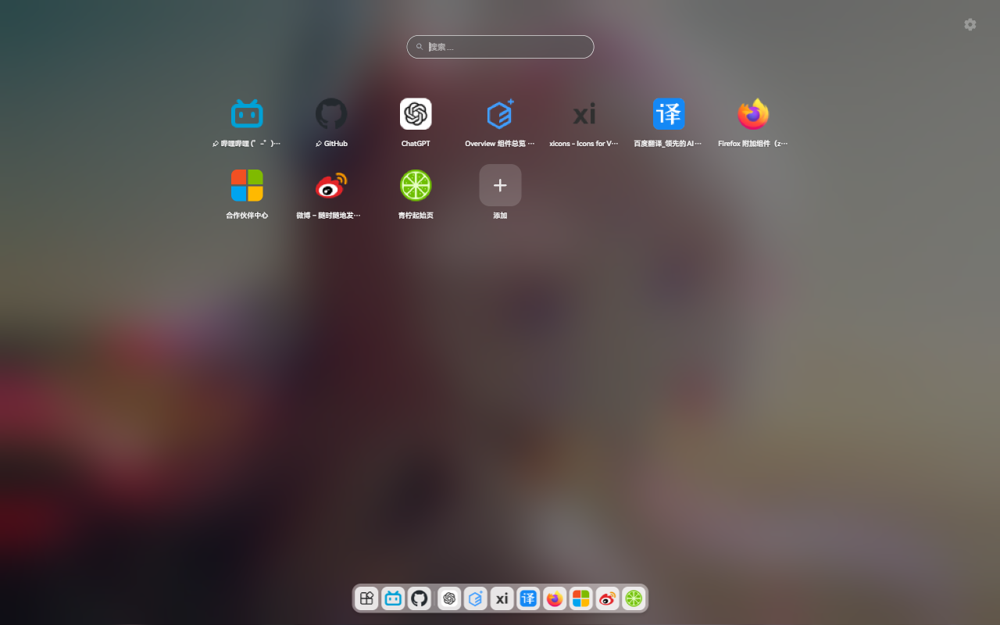
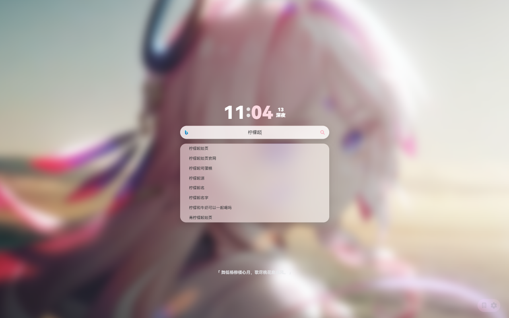
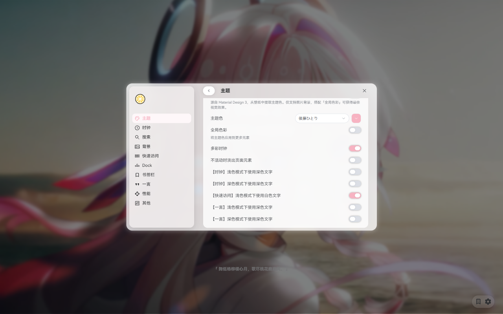

<p align="center">
  
</p>

<div align="center">

[English](README_en.md) | 简体中文  
[服务条款](docs/TERMS_OF_SERVICE.md) | [隐私政策](docs/PRIVACY_POLICY.md)

</div>

> [!IMPORTANT]
> 本项目（orange-new-tab）基于 [lemon-new-tab](https://github.com/Redlnn/lemon-new-tab) 二次开发。
> 上游项目由 [Red_lnn](https://github.com/Redlnn) 创作，并以 AGPL-3.0 许可证开源。
> 本仓库为其派生版本，保留上游许可证与版权声明；页面名称、图标与联系方式等品牌信息已替换。
> 上游仓库地址：<https://github.com/Redlnn/lemon-new-tab>

## 安装

本项目为个人二次开发版本，未上架应用商店。可 Clone 后手动 Build 使用：

```sh
git clone https://github.com/L1uZQ/orange-new-tab.git
cd orange-new-tab
pnpm install
pnpm build
```

然后在浏览器的扩展管理页以「加载已解压的扩展程序」载入 `.output/chrome-mv3`。

## 特性

让每次打开新标签页，都成为一次轻快、顺手又赏心悦目的开始。

橙子起始页是一款本地优先的开源浏览器扩展，无需额外注册账号。核心设置和个性化内容保存在浏览器中，页面加载迅速、界面简洁，也没有资讯流和广告干扰。

**🔍 灵活搜索**  
&emsp;&ensp;支持 Bing、Google、百度、DuckDuckGo、Yandex 等搜索引擎，提供搜索联想、搜索历史和自定义搜索引擎，让你用熟悉的方式快速找到内容。

**🧭 快速导航**  
&emsp;&ensp;自动展示最常访问的网站，也可以添加、置顶和拖动整理自己的链接。支持分组、分页、滚动浏览，也可切换为 Dock 和 Launchpad 样式，常用网站一目了然。

**🔖 浏览器书签**  
&emsp;&ensp;直接搜索、打开、编辑、删除和拖动整理浏览器书签，不必离开新标签页四处查找。

**🖼️ 丰富壁纸**  
&emsp;&ensp;支持 Bing 每日一图、在线图片 API、本地图片和视频壁纸，丰富的自定义选项让你的壁纸灵动起来。

**🎨 高度个性化**  
&emsp;&ensp;丰富的选项让布局、主题色、各种组件的布局与样式随你而变。更有能从壁纸提取的动态主题色，让整个页面自然协调。

**🕒 实用但不打扰**  
&emsp;&ensp;可显示时钟、日期、秒数和农历；每天展示古诗词、励志语录或你的自定义文字，也可一键复制。

**⚡ 快速且易用**  
&emsp;&ensp;针对加载和占用持续优化，支持响应式布局以及各种性能效果的独立开关。

**🔄 方便备份**  
&emsp;&ensp;支持导入、导出扩展设置，方便备份当前内容或迁移到其他设备

**⚛️ 使用更放心**  
&emsp;&ensp;橙子起始页以 AGPL-3.0 许可证完整开源所有代码，不会主动收集、发送任何隐私。支持 Chrome、Edge、Firefox，无论用什么浏览器都能获得一致的体验

## 更新日志（Changelog）

[中文](./docs/CHANGELOG.md) | [English](./docs/CHANGELOG_en.md)

## 浏览器兼容性

|                浏览器                | 支持 |          说明          |
| :----------------------------------: | :--: | :--------------------: |
|                Chrome                |  ✅  | Chrome 116 及更高版本  |
|                 Edge                 |  ✅  |  Edge 116 及更高版本   |
|               Firefox                |  ✅  | Firefox 128 及更高版本 |
|            Firefox Mobile            |  ❌  |  无法取代原生新标签页  |
|             Edge Mobile              |  ❌  |  无法取代原生新标签页  |
| 其他基于 Chromium<br/>的移动端浏览器 |  ❓  |        未经测试        |

> 橙子起始页自适应横竖屏模式，但未在移动端浏览器上测试及上架，故不保证兼容性

## 预览图

<details>
<summary>点击展开图片</summary>

  
  
  
  
  


</details>

### 与青柠起始页对比

> [!NOTE]  
> 本扩展模仿了青柠起始页的部分样式，根据个人需求开发，
> 很多功能都没有，但欢迎 PR，提 Issue 不一定会实现噢

|           主要功能           | 柠檬起始页 |    青柠起始页    |
| :--------------------------: | :--------: | :--------------: |
|         最常访问网站         |     ✅     |        ❌        |
|        查找浏览器书签        |     ✅     |        ❌        |
|          自定义壁纸          |     ✅     |        ✅        |
| 动态主题色<br />（莫奈取色） |     ✅     |        ❌        |
|           深色模式           |     ✅     |        ✅        |
|           视频壁纸           |     ✅     |        ✅        |
|             一言             |     ✅     |        ✅        |
|        自定义快速导航        |     ✅     | ✅（需注册账号） |
|        自定义搜索引擎        |     ✅     | ✅（需注册账号） |
|             便签             |     ✅     |        ✅        |
|             天气             |     ❌     |        ✅        |
|         个人项目推广         |     ❌     |        ✅        |

## 为什么会有这个扩展？

<details>
<summary>主要有以下几个原因（碎碎念警告）：</summary>
<br />

1. Chrome 设置默认搜索引擎为非 Google 后新标签页就没有搜索栏和壁纸
2. Chrome 搜索引擎改成 Bing 后和 Edge 一样新标签页变成了 Bing 首页，多余的按钮、新闻很丑，且搜索栏和快速导航都很靠上，不好看也不中用
3. 个人喜欢青柠起始页的外观，然而青柠起始页是一个每次打开都会进行一次 http 请求的网页，准确来讲其实是导航页而不是起始页（非常不能理解为什么要放在服务器上）
4. 青柠并不是原生浏览器扩展，不支持展示经常访问网站（同上，非常不能理解），而我个人更习惯直接打开经常访问的网站
5. 青柠起始页把快速导航放在了二级页面，而我更喜欢在新标签页中直接打开常用网站，虽然可以默认进入二级页面但是就看不到搜索栏了
6. 青柠起始页不是个开源项目不好魔改，所以我决定根据自己需求模仿一个
7. 怎么会有新标签页添加个快速导航或者搜索引擎都要注册账号的（继续不能理解）

> ~~听闻青柠起始页准备重构并且添加新功能了，也许新版会满足我的需求，然后就停更了呢？~~  
> 更新了，结果基本是 UI 调整，新功能不多（笑

</details>

## 开发

本项目使用 Vue 3 (TypeScript) + Element Plus 开发。

> [!WARNING]
>
> 1. 本人没系统学习过 HTML / CSS / JS / TS / Vue，代码质量可能不高
> 2. 本项目包含大量 AI 生成代码，仅经过简单 Review
>    确保功能正常，不包含恶意代码，其质量/性能或多或少可能存在问题，望各位谅解
> 3. 欢迎 PR

### 构建

#### 如果你使用 Chrome 浏览器

```sh
git clone https://github.com/L1uZQ/orange-new-tab.git
cd orange-new-tab
pnpm install
# pnpm dev  # 运行开发环境，会启动一个独立的浏览器
# 构建
pnpm build  # 构建为（未压缩的）Chrome 扩展
pnpm zip  # 打包 Chrome 扩展
```

#### 如果你使用 Firefox 浏览器

```sh
git clone https://github.com/L1uZQ/orange-new-tab.git
cd orange-new-tab
pnpm install
# pnpm dev  # 运行开发环境，会启动一个独立的浏览器
# 构建
pnpm build:firefox  # 构建为（未打包和签名的）Firefox 扩展
pnpm zip:firefox  # 打包 Firefox 扩展
```

#### 与上游同步

本仓库基于 [lemon-new-tab](https://github.com/Redlnn/lemon-new-tab) 开发，`upstream` 远端指向原仓库：

```sh
git fetch upstream          # 拉取上游更新
git merge upstream/master   # 将上游更新合并到当前分支
git push origin master      # 推送到本仓库
```

## 已知问题

1. 部分 Windows 设备上的 Chromium 内核浏览器会在启动时卡死，**禁用 GPU
   硬件加速**或者在 [Experiments](chrome://flags/#use-angle) 页面将
   **Choose ANGLE graphics backend** 更改为 `OpenGL` 后可缓解
   > - 考虑是因为显卡驱动 / 系统问题等原因造成
   > - Chromium 不推荐使用 OpenGL API 渲染，改成其他也可能会有效（可能会不卡但掉帧）

## 鸣谢

- [柠檬起始页 lemon-new-tab](https://github.com/Redlnn/lemon-new-tab)：本项目的上游来源，本项目基于它二次开发
- [青柠起始页](https://limestart.cn/)：柠檬起始页的模仿对象，模仿了布局和动画，参考了部分 CSS
- [Light Tab Page 轻标签页](https://github.com/Devifish/light-tab-page)：自定义壁纸储存的实现来源

## License

本项目以 AGPL-3.0 许可证开源，`entrypoints/newtab/assets` 中的涉及到商标的图片除外

### 修改声明

**本作品由 [L1uZQ](https://github.com/L1uZQ) 修改，修改日期 2026-10-26。**
上游原作品 [lemon-new-tab](https://github.com/Redlnn/lemon-new-tab) 的版权归
[Red_lnn](https://github.com/Redlnn) 所有。

依据 AGPL-3.0 第 5 条，本衍生版本在保留上游版权声明与许可证的前提下修改了：
名称与界面文案、应用图标、`wxt.config.ts` 中的作者与主页、关于/帮助对话框中的开发者
链接与联系方式、WebDAV 同步库与备份文件的默认目录及产品标识。完整修改历史见本仓库 Git 记录。

> 本项目自 v3.2.3 版本（commit 65a894c0d8009d274618c5004a634d7359b2b0a6）起采用 AGPL-3.0 许可证开源，之前版本采用 MIT 许可证开源
